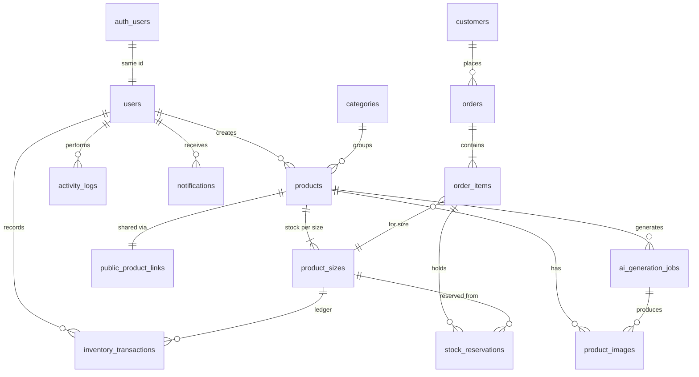
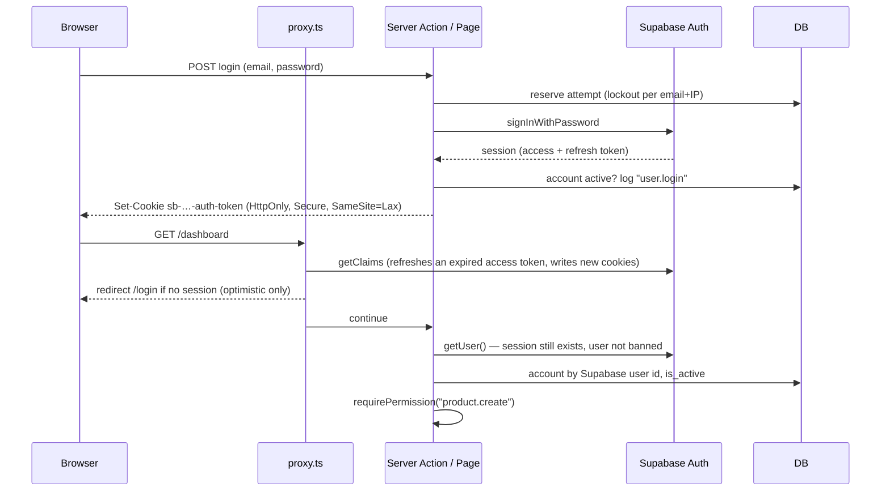
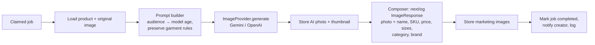
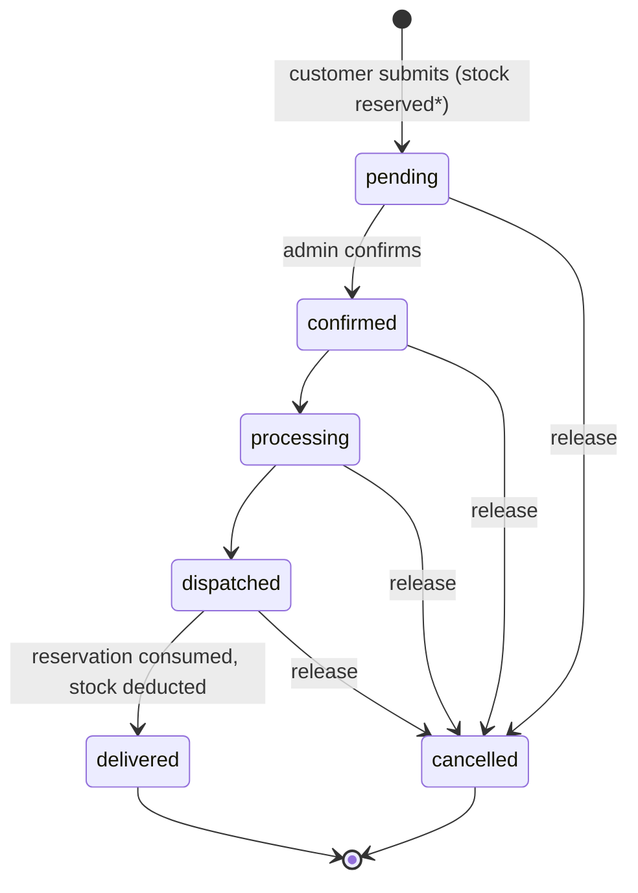

# Threadline — Architecture

Clothing inventory, AI product photography and order management for one clothing business.
Phase 1 is the internal management system; Phase 2 (public product pages and customer
ordering) is built on the same schema and modules, so nothing is rebuilt later.

---

## 1. System architecture

```mermaid
flowchart LR
  subgraph Browser
    Staff[Staff UI<br/>Next.js app router + shadcn/ui]
    Customer[Public product page /p/SKU]
  end

  subgraph Next[Next.js 16 server]
    Proxy[proxy.ts<br/>optimistic cookie check]
    Actions[Server Actions<br/>mutations]
    Routes[Route Handlers<br/>files, cron, worker, queries]
    DAL[Data access layer<br/>requireUser / requirePermission]
    Domain[Domain services<br/>products, inventory, orders, jobs]
  end

  subgraph Infra
    DB[(Postgres — Supabase<br/>Drizzle ORM)]
    Store[(Cloudinary<br/>or local disk in dev)]
    AI[AI image provider<br/>Gemini or OpenAI]
  end

  Worker[Job worker<br/>after() kick + cron sweep + optional long-running process]

  Staff --> Proxy --> Actions --> DAL --> Domain
  Customer --> Actions
  Staff --> Routes --> DAL
  Domain --> DB
  Domain --> Store
  Worker --> DB
  Worker --> AI
  Worker --> Store
```

Layering rules:

| Layer | Folder | Rule |
|---|---|---|
| UI | `src/app`, `src/components` | No DB access. Receives DTOs and the permission list from the server. |
| Actions / routes | `src/app/**/actions.ts`, `src/app/api` | Parse input with Zod, call `requirePermission`, call one domain service. |
| Domain services | `src/server/*` | All business rules and DB transactions. Framework-free, so tests and the worker call them directly. |
| Infrastructure | `src/server/db`, `src/server/storage`, `src/server/ai` | Swappable drivers behind small interfaces. |

Key choices:

- **Database:** PostgreSQL via Drizzle. Production default is **Supabase** (app on the transaction pooler, port 6543; migrations on the direct connection, port 5432; optional CA certificate for verified TLS). Neon also works (`@neondatabase/serverless` Pool is used automatically on `*.neon.tech` hosts). Local dev and tests use Postgres in Docker.
- **Storage:** `StorageDriver` interface. `cloudinary` driver in production (signed uploads, originals stored untouched, CDN delivery); `s3` driver as an alternative (Supabase Storage, R2, AWS S3, MinIO); `local` driver (`./storage`, served by `/api/files/...`) for development. Image binaries never go into Postgres.
- **Background jobs:** a durable Postgres queue (the `ai_generation_jobs` table), claimed with `FOR UPDATE SKIP LOCKED`. No in-memory timers. Details in section 8.
- **Auth:** **Supabase Auth** (passwords, sessions, password-reset emails) through `@supabase/ssr`, server-side only, session in HttpOnly cookies. Each `users` row has the id of its Supabase user (`users.id` → `auth.users.id`); the four-account rule, roles and active flag stay in `users`. No public registration.

---

## 2. Database ERD



---

## 3. Database schema (summary)

Full definitions: `src/server/db/schema.ts`. Money is stored as integer minor units
(paisa) to avoid float errors. All tables have `created_at`; mutable tables have `updated_at`.

| Table | Key columns and constraints |
|---|---|
| `users` | `slot smallint UNIQUE CHECK (slot BETWEEN 1 AND 4)`, `CHECK ((role='admin') = (slot=1))`, `email UNIQUE`, `is_active`, `id` = Supabase `auth.users.id` (FK). **The slot column makes a fifth account impossible at the database level.** |
| `login_attempts` | `email`, `ip`, `success`, `created_at` — login throttling. |
| `categories` | `name UNIQUE`, `slug UNIQUE`, `is_active`. Product type (T-Shirts, Hoodies...). |
| `products` | `sku UNIQUE DEFAULT 'CLO-' \|\| lpad(nextval('product_sku_seq'),6,'0')`, `name`, `description` (≤1000), `audience` enum (kids/youth/adult), `category_id FK`, `purchase_price_minor`, `selling_price_minor`, `status` enum (active/archived), `is_published`, `created_by FK`. |
| `product_sizes` | `UNIQUE(product_id,size)`, `size` enum (XS/S/M/L/XL), `on_hand`, `reserved`, `sold`; `CHECK on_hand>=0`, `CHECK reserved>=0`, `CHECK reserved<=on_hand`. |
| `product_images` | `kind` enum (original/ai_model/marketing), `storage_key`, `thumb_key`, `width`, `height`, `job_id FK NULL`, `is_primary`. |
| `inventory_transactions` | `product_size_id FK`, `type` enum (initial, stock_in, adjustment, stock_out, reserve, release, sale), `on_hand_delta`, `reserved_delta`, `on_hand_after`, `reserved_after`, `reason`, `order_id NULL`, `user_id NULL`. **UPDATE/DELETE blocked by trigger.** |
| `ai_generation_jobs` | `product_id FK`, `status` enum (pending/processing/completed/failed), `provider`, `attempts`, `max_attempts`, `run_after`, `locked_until`, `last_error`, `requested_by`. **Partial UNIQUE index on product_id WHERE status IN (pending, processing)** = duplicate job prevention. |
| `public_product_links` | `product_id UNIQUE FK`, `slug UNIQUE` (= SKU, never changes), `is_active`, `view_count`. |
| `customers` | `phone UNIQUE`, `name`, `whatsapp`, `address`, `city`. |
| `orders` | `order_number UNIQUE DEFAULT 'ORD-' \|\| lpad(nextval('order_number_seq'),6,'0')`, `customer_id FK`, `status` enum, delivery snapshot (name, phone, address, city), `notes`, `total_minor`, status timestamps. |
| `order_items` | snapshot: `product_name`, `sku`, `size`, `unit_price_minor`, `unit_cost_minor`, `quantity`; plus `product_id`, `product_size_id` FKs. |
| `stock_reservations` | `order_item_id FK`, `product_size_id FK`, `quantity`, `status` enum (active/released/consumed). |
| `activity_logs` | `user_id NULL` (NULL = customer/system), `action`, `entity_type`, `entity_id`, `metadata jsonb`, `ip`. **UPDATE/DELETE blocked by trigger.** |
| `notifications` | `user_id FK`, `type`, `title`, `body`, `href`, `read_at`. |
| `settings` | single row (`id = 1`): brand name, currency, low-stock threshold, reservation policy, pending-order expiry, auto-publish. |

---

## 4. Authentication and authorization



- **Four accounts:** admin is created by `pnpm db:seed` (from `ADMIN_EMAIL` / `ADMIN_PASSWORD`). The admin creates users into free slots 2–4: first the Supabase user (admin API, email confirmed), then the `users` row; if the row fails (slot taken, race) the Supabase user is deleted again. The DB `slot` constraint is the hard limit; the app checks first to show a clear message. A Supabase user without a `users` row has no access, so turning public sign-ups on by mistake grants nothing. Accounts are deactivated, never deleted (they own history).
- **Roles:** `admin`, `staff`. The permission matrix lives only on the server (`src/server/auth/permissions.ts`). The client receives the computed permission list for showing/hiding UI. Every action and route handler calls `requirePermission(...)` again.

| Permission | Admin | Staff |
|---|:-:|:-:|
| `dashboard.view`, `product.view`, `product.create`, `inventory.view`, `inventory.stock_in`, `ai.view`, `link.view` | ✓ | ✓ |
| `product.edit`, `product.archive`, `product.publish`, `ai.regenerate` | ✓ | |
| `inventory.adjust`, `inventory.stock_out` | ✓ | |
| `order.view`, `order.manage`, `customer.view` | ✓ | |
| `user.manage`, `activity.view`, `settings.manage`, `price.cost_view_all` | ✓ | |

Staff can see purchase prices (they enter them). Nobody can delete products or inventory transactions — products are archived, transactions are immutable at the DB level.

- **Sessions:** Supabase access token (1 hour) + refresh token, refreshed in `proxy.ts`. Every page and action verifies with `getUser()`, so a deleted session is dead at once. Logout ends this browser's Supabase session. Deactivation bans the Supabase user and deletes its `auth.sessions`. An admin password reset or a password change signs out every other device. 5 failed logins per email+IP in 15 minutes → temporary lock (the app's own limit, in front of Supabase's).
- **Shoppers:** separate Supabase users with a `customer_accounts` row (Google or email + password, email confirmation). Browsing `/shop` and `/p/{SKU}` is open; `placeOrderAction` requires a shopper session and links the order (`orders.customer_account_id`). A team account is never a shopper and vice versa; a Google session for a team email is signed out. `/auth/confirm` handles email links and Google, and sends reset links to the right page.
- **Forgot password:** `/forgot-password` → Supabase recovery email (only for active accounts; same answer either way; 5/hour per IP, 3/hour per email) → `/auth/confirm` (token_hash or PKCE code) → `/reset-password`.

---

## 5. Product creation workflow

```mermaid
flowchart TD
  A[1 Upload picture<br/>drag-drop, preview, JPG/PNG/WebP ≤ 8 MB] --> B[2 Total quantity]
  B --> C[3 Name, description, category]
  C --> D[4 Kids / Youth / Adult cards]
  D --> E[Size inputs for that group<br/>live total vs target]
  E --> F[5-6 Purchase & selling price<br/>live profit, margin, totals]
  F --> G[Save]
  G --> H{Server: Zod validation<br/>sizes valid for group<br/>sum == quantity}
  H -- invalid --> X[Field errors]
  H -- valid --> I[Verify image bytes with sharp,<br/>upload original + thumbnail]
  I --> J[DB transaction:<br/>product + SKU, sizes, image,<br/>initial stock txns, public link,<br/>AI job, activity log]
  J -- fails --> K[Delete uploaded objects]
  J -- ok --> L[Response: SKU + link]
  L --> M[after(): kick job worker]
```

Size map (shared by client and server, `src/lib/sizes.ts`): Kids → XS, S, M · Youth → XS, S, M, L · Adult → M, L, XL.
The audience is fixed after creation because it decides which size rows exist.

---

## 6. Inventory calculation logic

Per size row: `on_hand` (physically in stock), `reserved` (held for open orders, part of `on_hand`), `sold` (delivered).

- `available = on_hand − reserved` (what customers can order).
- Product totals = sums over its sizes.
- Low stock: `0 < available ≤ settings.low_stock_threshold`. Out of stock: `available = 0`.
- Total purchase value = Σ `purchase_price × on_hand`. Potential sales value = Σ `selling_price × on_hand`. **Estimated gross profit** = difference.
- **Realized profit** = Σ over delivered order items `(unit_price − unit_cost) × quantity` (from order snapshots), shown separately.

Every stock change goes through `applyStockChange()` inside a DB transaction:

```sql
UPDATE product_sizes
   SET on_hand = on_hand + $d_on_hand, reserved = reserved + $d_reserved, sold = sold + $d_sold
 WHERE id = $id
   AND on_hand + $d_on_hand >= 0
   AND reserved + $d_reserved >= 0
   AND reserved + $d_reserved <= on_hand + $d_on_hand
RETURNING on_hand, reserved;
```

No row returned → the change would break a rule → transaction rolls back with a clear error.
The same statement writes the ledger row. A conditional single-statement update is atomic,
so two customers ordering the last piece at once cannot both succeed (no overselling).
The CHECK constraints are the final safety net.

| Event | on_hand | reserved | sold | Ledger type |
|---|---|---|---|---|
| Product created | +q | | | `initial` |
| Stock in | +q | | | `stock_in` |
| Adjustment (admin, reason required) | ±q | | | `adjustment` |
| Stock out (damage, loss, sold offline) | −q | | | `stock_out` |
| Order reserved | | +q | | `reserve` |
| Order cancelled / expired | | −q | | `release` |
| Order delivered | −q | −q | +q | `sale` |

---

## 7. AI image generation architecture



- `ImageProvider` interface (`src/server/ai/provider.ts`): `generate({ sourceImage, prompt, count }) → images[]`. Providers: `cloudflare` (default, free FLUX.2 [klein] on Workers AI), `gemini` (paid, Nano Banana), `openai` (`/v1/images/edits`). Selected by `AI_IMAGE_PROVIDER`, with `AI_FALLBACK_PROVIDER` taking over when the free daily allowance runs out; staff can also pick a provider when regenerating. Adding a provider is one file.
- The prompt asks for a realistic, fully clothed, age-appropriate model wearing the exact garment, keeping colors, fabric, logos and patterns, in a clean commercial setting. Kids → child model; Youth → teenager; Adult → adult.
- **Text is never drawn by the AI.** Name, SKU, price, sizes, category and brand are rendered by a deterministic template (`src/server/ai/compose.tsx`) on top of the AI photo, using bundled fonts. Output: a portrait marketing card (1080×1350) per variation.
- 2 variations per job by default (`AI_VARIATIONS`).
- No provider key → the job fails with "AI provider not configured"; the product is unaffected, and the admin can regenerate later.

---

## 8. Background job architecture

The queue is the `ai_generation_jobs` table — durable, transactional with product creation, and visible in the UI.

1. **Enqueue** inside the product transaction (`status=pending`). The partial unique index prevents two active jobs per product.
2. **Claim:**
   ```sql
   UPDATE ai_generation_jobs SET status='processing', attempts=attempts+1, locked_until=now()+'5 min'
    WHERE id = (SELECT id FROM ai_generation_jobs
                 WHERE (status='pending' AND run_after<=now())
                    OR (status='processing' AND locked_until<now())   -- crashed worker
                 ORDER BY run_after FOR UPDATE SKIP LOCKED LIMIT 1)
   RETURNING *;
   ```
3. **Run** the pipeline from section 7.
4. **Finish:** `completed`, or on error `pending` again with `run_after = now() + 30s × 4^attempts` until `max_attempts` (3), then `failed` with `last_error`.

Three triggers drive `runWorker()`, all safe to run at the same time thanks to `SKIP LOCKED`:

| Trigger | Where | Purpose |
|---|---|---|
| `after()` kick | product create / regenerate actions | Start work right after the response. |
| Cron sweep | `GET /api/cron/worker` with `CRON_SECRET` (Vercel Cron every minute, or system cron) | Retries, crashed jobs, pending-order expiry. |
| Long-running worker | `pnpm worker` | For VPS / Docker deployments. |

Monitoring: the **AI Product Images** page lists jobs by status with attempts, errors, durations and a Retry/Regenerate button.

---

## 9. Public product page architecture

- URL: `/p/{SKU}` (e.g. `/p/CLO-000001`). The slug is the SKU, which never changes, so the link is stable through edits.
- Data comes only from `getPublicProduct(slug)` (`src/server/public/products.ts`), which selects a whitelist of columns into a `PublicProduct` type: name, SKU, description, audience, category name, selling price, sizes with availability, image URLs. Purchase prices, margins, user data and internal IDs never leave the server. Size selection uses the size code, not a DB id.
- Visible only when the link is active, the product is `active` and `is_published`. Otherwise 404.
- Server-rendered with OpenGraph metadata (marketing image), so links preview nicely in WhatsApp/Facebook.
- Lives in its own route group `(public)` with its own layout — no admin chrome.

---

## 10. Order management workflow



\* Reservation policy (settings): `on_order` (default, reserve at submission) or `on_confirm` (check at submission, reserve at confirmation). Pending orders older than `pending_order_expiry_hours` (0 = never) are cancelled by the cron sweep and their stock released.

Order submission (one transaction): validate input (Zod, honeypot, per-IP rate limit) → find published product and size → upsert customer by phone → create order and item snapshot → reserve with the guarded update from section 6 → ledger + reservation rows → activity log + notifications for staff → show confirmation with the order number.

---

## 11. Implementation roadmap

| Phase | Scope | Exit check |
|---|---|---|
| 1 Foundation | Next.js, Drizzle schema + migrations + triggers, DB drivers, Supabase Auth, four-account limit, RBAC, app shell, user management | Tests: 5th account rejected by DB; staff blocked from admin actions; login/logout/throttle. |
| 2 Inventory | Dashboard, create-product wizard, upload, SKU, sizes, prices, product list/filters/detail/edit/archive, inventory module, ledger, activity logs | Tests: concurrent SKUs unique; size sum rules; negative stock rejected; ledger immutable. |
| 3 AI automation | Queue, worker triggers, providers, composer, storage of results, job monitor, regenerate, notifications | Tests: claim/retry/backoff/fail; duplicate job blocked; composition output. |
| 4 Public pages | `/p/[sku]`, link management, OG metadata, data separation | Test: public HTML has no purchase price; unpublished → 404. |
| 5 Orders | Order form, reservation, status workflow, customers, expiry sweep | Tests: 20 concurrent orders for 5 pieces → exactly 5 succeed; cancel releases; deliver deducts. |
| 6 Production | Security headers, rate limits, error states, responsive pass, e2e (Playwright), deployment guide | Full e2e flow passes. |
